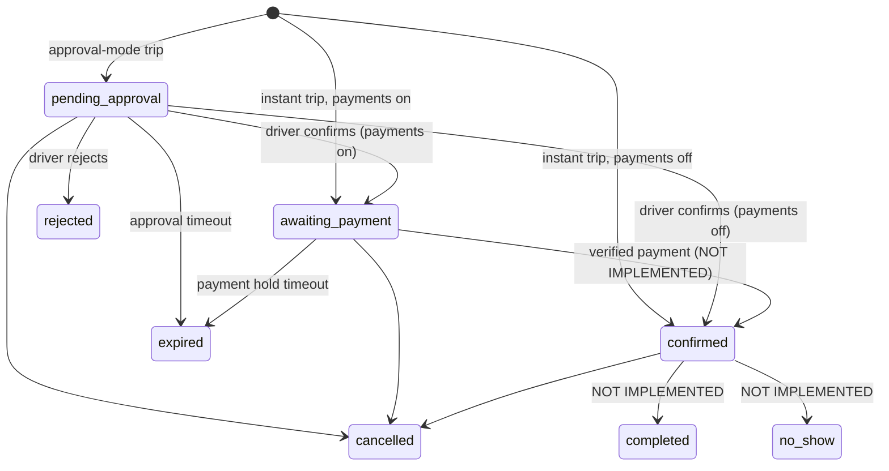

# Architecture (as implemented)

Modular monolith: NestJS 11 (CommonJS) + PostgreSQL 16/PostGIS, SQL migrations applied by a small runner
(`apps/api/src/database/migrator.ts`, `database/migrations/*.sql`). Modules: `auth`, `users`, `drivers`, `trips`,
`bookings`, `admin`, `audit`, `settings`, `health`, `database`.

## Material deviations from the original brief (and why)
| Brief | Implemented | Reason |
|---|---|---|
| Prisma ORM | `pg` + hand-written SQL migrations | Prisma engine binaries could not be downloaded in the build sandbox; the booking engine also needs explicit `SELECT … FOR UPDATE` and PostGIS SQL, which Prisma does not express natively. |
| pnpm | npm workspaces | Simplicity; no functional difference yet. |
| NestJS latest (12) | NestJS 11 | v12 is ESM-only and incompatible with the CommonJS/ts-jest toolchain used here. |
| zod schemas in `packages/validation` | schemas live in `apps/api` | No second consumer exists yet; extract when the web app is added. |
| Redis/BullMQ | none | No background work exists yet; booking expiry is a callable, idempotent method (`BookingsService.expireStale`) awaiting a scheduler. |

## Booking state machine

`pending_approval`, `awaiting_payment`, `confirmed` hold seats; leaving them releases seats. Payment/refund states are intentionally
not booking states (future `payments`/`refunds` tables). A driver cannot confirm an `awaiting_payment` booking (test-covered).

## Segment seat inventory
A trip with stops 0..n has segments 0..n-1 (`trip_segments`). A booking from stop *a* to *b* occupies segments *a..b-1*, so a seat
vacated at an intermediate stop is resold on the remainder. Guarantees, outermost first:
1. **Lock protocol** – every mutation first locks the affected segment rows `FOR UPDATE` in ascending `seq`, *then* booking rows. One global order ⇒ no deadlocks (stress-tested with concurrent book/cancel/reject/trip-cancel).
2. **Application check** – capacity verified under those locks (`assertCapacity`).
3. **Database CHECK** – `segment_not_overbooked` (`0 <= seats_booked <= seats_total`) makes overbooking impossible even for buggy code or raw SQL.
4. **Unique partial index** – one seat-holding booking per passenger per trip.
5. **Idempotency** – `idempotency_records` row is inserted in the same transaction as the booking; concurrent duplicates block on the unique key then replay the stored response. Only *successful* outcomes are stored (a failed attempt rolls back and may be retried).

Isolation level is READ COMMITTED; correctness comes from the locks above rather than SERIALIZABLE retries.

```mermaid
sequenceDiagram
  participant C as Client
  participant API as BookingsService.create
  participant DB as PostgreSQL
  C->>API: POST /trips/:id/bookings (Idempotency-Key)
  API->>DB: BEGIN; INSERT idempotency_records ON CONFLICT DO NOTHING
  alt key already used
    DB-->>API: existing row
    API-->>C: 200 replay (or 422 if body differs)
  else new key
    API->>DB: SELECT trip_segments FOR UPDATE (ascending seq)
    API->>DB: read trip status/lead time (after locks)
    API->>API: assertCapacity
    API->>DB: UPDATE seats_booked; INSERT booking + history; store response
    DB-->>API: COMMIT
    API-->>C: 201
  end
```

## Authentication and authorization
- scrypt password hashes (parameters stored in the hash); constant-time compare; dummy hash for unknown e-mails.
- 15-min HS256 access JWT (`sub`,`sid`). `AuthGuard` re-reads session, account status and permissions from the DB on **every** request ⇒ suspension/revocation is immediate; JWT is never trusted for permissions.
- 30-day refresh token in an `HttpOnly; SameSite=Strict; Path=/api/v1/auth` cookie, stored only as SHA-256, rotated on use; replay of a rotated token revokes all of the user's sessions. Cookie endpoints also require `X-Requested-With: fetch` (CSRF).
- Roles → permissions in tables; routes declare `@RequirePermissions`. Resource checks (owner/driver) return **404** for outsiders to prevent ID probing. Staff accounts are protected from non-super administrators.

## Trust boundaries
Internet → API (helmet headers, 100 kB body limit, zod validation, in-memory rate limit on auth routes) → PostgreSQL (parameterised queries only). No object storage, mail provider, payment provider or map provider is connected.
